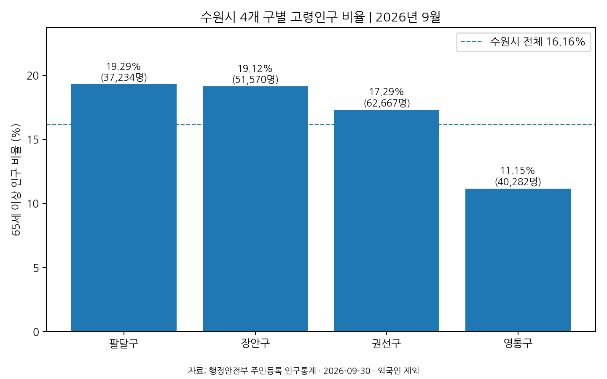
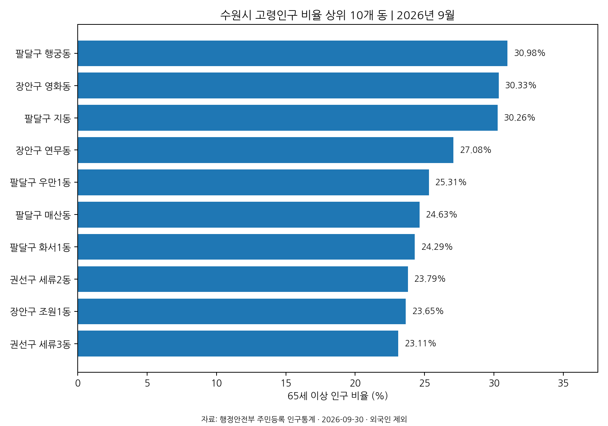
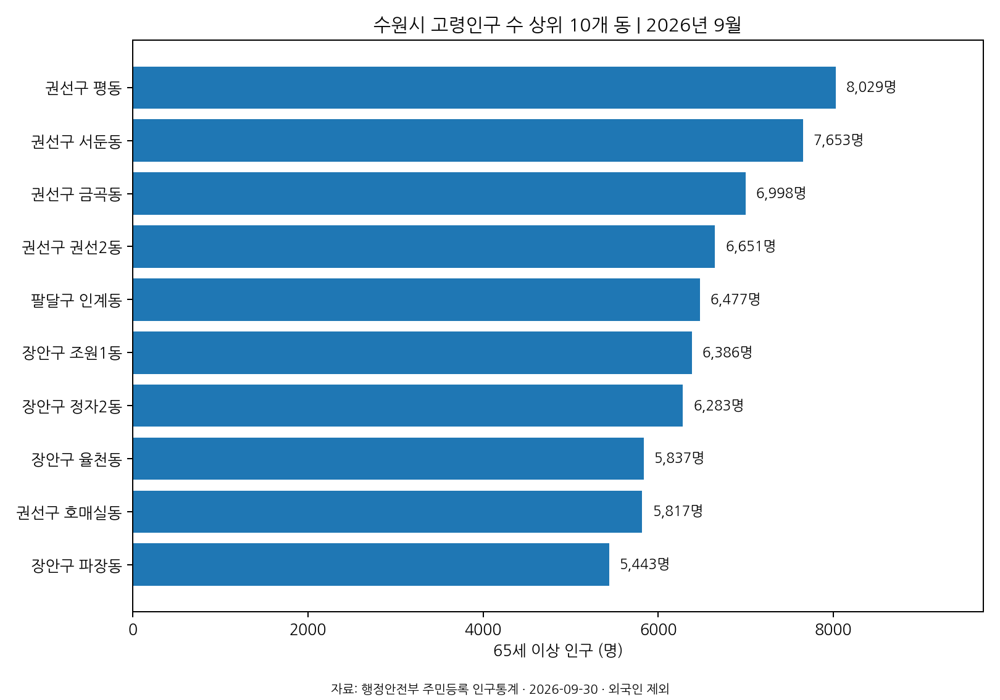

<div align="center">

# 수원시 교통약자 이동 접근성 분석
### 친환경 DRT 개선 방안 연구

**2026 AI 교통문제 해결 공모전**

대중교통은 모두에게 편리한가?

수원시 고령인구 분포 분석을 기반으로 교통약자의 이동 접근성 개선 방향을 탐색하는 데이터 분석 프로젝트

**Team H&C Labs**

---

**Python** | **Public Data** | **Data Analysis** | **Matplotlib** | **Transportation**

</div>

<br>

## 01. 프로젝트 소개

### 1.1 연구 배경

> 대중교통은 모두에게 동일하게 편리한 이동 수단일까?

대중교통은 많은 시민이 이용하는 필수 이동 수단이지만, 연령과 신체적 조건, 거주 지역에 따라 접근성과 이용 편의성에 차이가 발생할 수 있습니다.

특히 고령인구가 많은 지역에서는 정류장 접근성, 배차간격, 교통수단 이용 편의성 등을 함께 고려할 필요가 있습니다.

본 프로젝트는 수원시의 고령인구 분포를 공공데이터로 분석하고, 향후 대중교통 접근성 데이터와 결합해 친환경 DRT(수요응답형 교통)의 개선 방향을 검토하기 위해 시작했습니다.

### 1.2 프로젝트 개요

| 항목 | 내용 |
|---|---|
| 프로젝트명 | 수원시 교통약자 이동 접근성 분석 및 친환경 DRT 개선 방안 연구 |
| 참여 공모전 | 2026 AI 교통문제 해결 공모전 |
| 팀명 | H&C Labs (가칭) |
| 연구 지역 | 경기도 수원시 |
| 분석 단위 | 4개 구, 44개 행정동 |
| 주요 분석 대상 | 65세 이상 주민등록인구 |
| 데이터 기준 | 2026년 9월 |
| 데이터 출처 | 행정안전부 |
| 분석 언어 | Python |
| 시각화 | Matplotlib |

### 1.3 연구 목표

- 수원시 지역별 고령인구 분포 파악
- 고령인구 비율과 인구수의 공간적 차이 비교
- 교통 접근성 추가 분석을 위한 기초자료 구축
- 저상 친환경 DRT 개선 방안 검토를 위한 분석 기반 마련

---

## 02. 데이터 수집 및 전처리

### 2.1 활용 데이터

행정안전부에서 제공하는 월간 주민등록인구 통계를 사용했습니다.

| 항목 | 내용 |
|---|---|
| 제공기관 | 행정안전부 |
| 데이터명 | 행정동별 연령별 인구현황 |
| 기준월 | 2026년 9월 |
| 분석 지역 | 수원시 |
| 데이터 형식 | Excel (.xlsx) |
| 분석 대상 | 전체 주민등록인구 및 65세 이상 인구 |

**원본 데이터**

[행정안전부 주민등록 인구통계](https://jumin.mois.go.kr/ageStatMonth.do)

### 2.2 데이터 처리 과정

```text
원본 Excel 데이터
        |
        v
파일 구조 및 기준월 검증
        |
        v
수원시 데이터 추출
        |
        v
행정구역별 인구 집계
        |
        +-- 4개 구
        |
        +-- 44개 행정동
        |
        v
65세 이상 인구 계산
        |
        v
고령인구 비율 산출
        |
        v
집계 결과 교차 검증
        |
        v
CSV 및 시각화 결과 생성
```

### 2.3 데이터 검증

분석 결과의 신뢰성을 높이기 위해 다음 항목을 검증하도록 구성했습니다.

- 연령대별 인구 합계 확인
- 남녀 인구 합계 확인
- 행정동별 집계 결과 확인
- 44개 행정동 합계와 4개 구 합계 비교
- 구별 합계와 수원시 전체 인구 비교
- 예상하지 못한 파일 형식 및 행정구역 구성 감지

검증 조건이 충족되지 않으면 분석을 중단하도록 구성했습니다.

---

## 03. 주요 분석 결과

### 3.1 수원시 고령인구 현황

2026년 9월 주민등록인구 자료를 기준으로 수원시의 고령인구를 분석했습니다.

| 분석 항목 | 결과 |
|---|---:|
| 수원시 전체 주민등록인구 | 1,186,308명 |
| 65세 이상 인구 | 191,753명 |
| 고령인구 비율 | 16.16% |
| 분석 대상 구 | 4개 |
| 분석 대상 행정동 | 44개 |

### 3.2 주요 지역별 분석 결과

| 구분 | 지역 | 분석 결과 |
|---|---|---:|
| 고령인구 비율 최고 | 팔달구 행궁동 | 30.98% |
| 고령인구 수 최고 | 권선구 평동 | 8,029명 |

### 3.3 결과 해석

**고령인구 비율과 절대 인구수는 서로 다른 정보를 제공합니다.**

- 고령인구 비율은 특정 지역의 인구 구조를 이해하는 지표입니다.
- 고령인구 수는 해당 지역에 거주하는 고령자의 규모를 파악하는 지표입니다.
- 두 지표를 함께 살펴보면 지역별 인구 특성을 보다 구체적으로 비교할 수 있습니다.

다만 고령인구 비율이 높다는 이유만으로 해당 지역의 교통 접근성이 낮거나 실제 이동 불편이 크다고 단정할 수는 없습니다.

현재 결과는 **고령인구 분포에 대한 분석**이며, 교통약자 전체의 규모나 실제 이동 제약을 측정한 결과는 아닙니다.

---

## 04. 데이터 시각화

지역별 차이를 비교하기 위해 Matplotlib을 활용해 그래프를 생성했습니다.

### 4.1 수원시 구별 고령인구 비율



- 수원시 4개 구의 고령인구 비율 비교
- 지역별 인구 구조 차이 확인

### 4.2 고령인구 비율 상위 10개 행정동



- 행정동별 고령인구 비율 비교
- 고령인구 비중이 높은 지역 확인

### 4.3 고령인구 수 상위 10개 행정동



- 행정동별 고령인구 규모 비교
- 고령인구 수가 많은 지역 확인

---

## 05. 분석 방법 및 기술 스택

### 5.1 기술 스택

| 구분 | 기술 | 활용 목적 |
|---|---|---|
| Language | Python 3.10+ | 데이터 처리 및 분석 |
| Data Source | Excel | 원본 인구통계 자료 |
| Data Processing | Python Standard Library | 엑셀 데이터 처리 및 집계 |
| Visualization | Matplotlib | 분석 결과 그래프 생성 |
| Output | CSV, PNG, TXT | 분석 결과 저장 |
| Version Control | GitHub | 코드 및 결과 관리 |

### 5.2 분석 로직

**1. 원본 데이터 검증**

- 파일 형식 및 기준월 확인
- 행정구역 구성 확인
- 연령대별·성별 합계 검증

**2. 고령인구 집계**

- 수원시 4개 구 및 44개 행정동 데이터 추출
- 65세 이상 인구 합산
- 행정구역별 전체 인구와 고령인구 비교

**3. 분석 결과 산출**

- 구별 고령인구 비율 계산
- 행정동별 고령인구 비율 계산
- 고령인구 비율 및 인구수 기준 정렬

**4. 결과 시각화**

- 구별 고령인구 비율 그래프
- 고령인구 비율 상위 10개 동 그래프
- 고령인구 수 상위 10개 동 그래프

---

## 06. 프로젝트 구조

```text
2026aicontest/
|
+-- README.md
+-- .gitignore
+-- requirements.txt
+-- analyze_202609_population.py
|
+-- data/
|   +-- raw/
|       +-- 202609_202609_연령별인구현황_월간.xlsx
|
+-- results/
    +-- suwon_gu_65plus_202609.csv
    +-- suwon_dong_65plus_202609.csv
    +-- suwon_gu_elderly_pct_202609.png
    +-- suwon_dong_elderly_pct_top10_202609.png
    +-- suwon_dong_elderly_count_top10_202609.png
    +-- analysis_summary_202609.txt
```

### 주요 파일 설명

| 파일 | 설명 |
|---|---|
| `analyze_202609_population.py` | 인구 데이터 분석 코드 |
| `requirements.txt` | 실행에 필요한 패키지 |
| `data/raw/` | 원본 인구통계 자료 |
| `results/*.csv` | 구별·행정동별 분석 결과 |
| `results/*.png` | 데이터 시각화 결과 |
| `results/*.txt` | 분석 요약문 |

---

## 07. 실행 방법

Python 3.10 이상이 필요합니다.

### 7.1 저장소 다운로드

```bash
git clone https://github.com/parkchaerin84/2026aicontest.git

cd 2026aicontest
```

### 7.2 패키지 설치

Windows PowerShell:

```powershell
py -m pip install -r requirements.txt
```

macOS / Linux:

```bash
python3 -m pip install -r requirements.txt
```

### 7.3 분석 실행

Windows PowerShell:

```powershell
py analyze_202609_population.py --input "data/raw/202609_202609_연령별인구현황_월간.xlsx" --out results
```

macOS / Linux:

```bash
python3 analyze_202609_population.py --input "data/raw/202609_202609_연령별인구현황_월간.xlsx" --out results
```

### 7.4 실행 결과

분석이 완료되면 `results/` 폴더에 다음 파일이 생성됩니다.

- CSV 2개
- PNG 그래프 3개
- 분석 요약문 TXT 1개

---

## 08. 연구의 한계

본 프로젝트의 현재 분석 결과는 고령인구의 지역별 분포를 파악한 것입니다.

다음 항목은 아직 별도의 분석이나 검증이 필요합니다.

- 버스정류장까지의 실제 접근거리
- 대중교통 배차간격
- 저상버스 이용 가능성
- 교통약자의 실제 이동 수요
- 지역별 대중교통 접근성
- DRT 도입에 따른 이동시간 및 접근성 변화

**고령인구가 많은 지역이 반드시 교통취약지역인 것은 아닙니다.**

따라서 인구 자료만으로 DRT 도입 우선순위나 정책 효과를 확정하지 않습니다.

또한 주민등록인구 통계에는 외국인이 포함되지 않으므로 해석 시 주의가 필요합니다.

---

## 09. 향후 연구 방향

### 9.1 대중교통 접근성 분석

- 버스정류장 위치 데이터 수집
- 행정동별 정류장 접근거리 분석
- 배차간격 및 대중교통 공급 수준 검토
- 고령인구 분포와 대중교통 접근성 비교

### 9.2 교통약자 이동 편의성 검토

- 저상버스 이용 가능성 분석
- 고령인구 밀집 지역의 이동 환경 검토
- 추가 교통약자 관련 데이터 확보

### 9.3 친환경 DRT 개선 방안

- 대중교통 공급이 부족한 지역의 보완 가능성 검토
- 저상 친환경 DRT 운영 방안 연구
- 실제 관측 데이터와 가상 시뮬레이션 데이터 구분
- 정책 적용 가능성과 한계 검증

---

## 10. 프로젝트 진행 현황

| 구분 | 진행 상태 |
|---|---|
| 연구 주제 및 분석 범위 설정 | 완료 |
| 행정안전부 인구 데이터 확보 | 완료 |
| 수원시 고령인구 집계 | 완료 |
| 구별·행정동별 비교 분석 | 완료 |
| 데이터 검증 및 시각화 | 완료 |
| 대중교통 접근성 데이터 결합 | 추가 분석 필요 |
| 저상 친환경 DRT 효과 검증 | 별도 검증 필요 |

---

## 11. 데이터 출처 및 유의사항

**데이터 제공기관**

행정안전부

**데이터명**

행정동별 연령별 인구현황(월간)

**데이터 기준**

2026년 9월

**공식 사이트**

https://jumin.mois.go.kr/ageStatMonth.do

본 연구에 사용된 원본 파일은 분석 당시 제공받은 다운로드 자료입니다.

원본 자료의 외부 공개 및 재배포 전에는 해당 사이트의 이용조건을 확인해야 합니다.

실제 관측 데이터와 가상 시뮬레이션 데이터는 혼동하지 않도록 구분합니다.

---

<div align="center">

### H&C Labs

**2026 AI 교통문제 해결 공모전**

수원시 교통약자의 이동 접근성 개선을 위한 데이터 기반 연구

</div>
