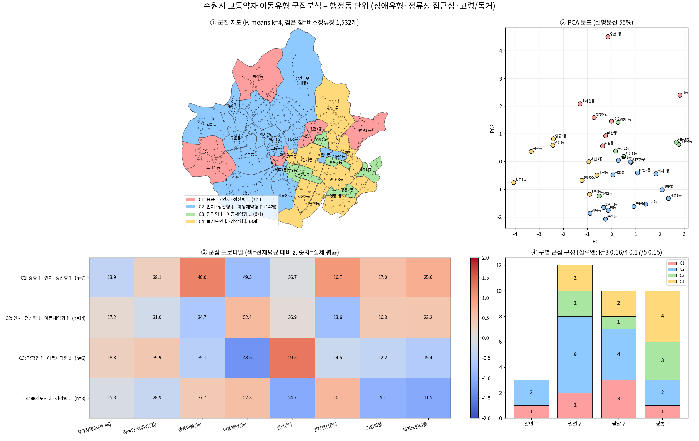

# 수원시 교통약자 이동유형 군집분석

수원시 행정동(44개 → 분석단위 35개)을 **장애유형 구성 · 버스정류장 접근성 · 고령화/독거노인 비율**로 K-means 군집화한 분석 코드입니다.



## 사용 데이터
| 데이터 | 기준 | 출처 | 저장소 포함 |
|---|---|---|---|
| 경기도 등록장애인 집계현황(읍면동·유형·정도별) | 2025.07 | 공공데이터포털 / 경기도 | ✗ (`data/` 폴더에 직접 배치) |
| 국토교통부 전국 버스정류장 위치정보 | 2025.10.31 | 공공데이터포털 | ✗ (용량 20MB, 직접 배치) |
| 동별 고령화율·독거노인 비율 | 2023.06 | 수원시정연구원 정책Brief 제39호 | ✓ `data/suwon_dong_aging_solo_2023-06.csv` (PDF 표를 옮겨 적음) |
| 행정동 경계 | 2025.01.01 | [vuski/admdongkor](https://github.com/vuski/admdongkor) | 최초 실행 시 자동 다운로드 |

> 원자료 파일명은 `data/README.md`를 참고해 그대로 맞춰 주세요. 각 데이터의 이용 조건은 제공기관 약관을 따릅니다.

## 실행
```bash
pip install -r requirements.txt
python src/suwon_dong_cluster.py      # 결과: results/ 에 PNG, CSV 생성
```
한글 폰트(맑은 고딕 / AppleGothic / 나눔고딕 / Noto Sans CJK)가 설치되어 있어야 그림의 한글이 깨지지 않습니다.

## 방법
1. 행정동 경계와 정류장 좌표를 공간결합(point-in-polygon)해 동별 정류장 수·밀도 산출
2. 장애유형을 이동제약(지체·뇌병변) / 감각(시각·청각·언어) / 인지·정신(지적·자폐성·정신·뇌전증)으로 묶어 비율 산출
3. 8개 변수(정류장 밀도, 정류장당 장애인 수, 중증 비율, 유형 3종 비율, 고령화율, 독거노인 비율) 표준화 후 K-means
4. 군집 수는 3~5개 중 실루엣 계수가 가장 높은 값 선택 (이번 결과: k=4)

## 결과 요약 (`results/suwon_dong_cluster_table.csv`)
| 군집 | 동 수 | 특징 |
|---|---|---|
| C1 | 7 | 중증·인지정신형 비중 높음, 정류장 밀도 낮음 (우만1동, 지동, 금곡동 등) |
| C2 | 14 | 이동제약형 중심의 기준 집단 |
| C3 | 6 | 감각형 높음·이동제약형 낮음 (세류3동, 매탄4동 등) |
| C4 | 8 | 고령·독거 낮음, 정류장당 장애인 적음 (광교1동, 영통3동 등) |

## 한계 (꼭 읽어 주세요)
- **군집 분리가 약함**: 실루엣 계수 0.15~0.17. 뚜렷한 유형이라기보다 연속적 분포를 나눈 경향으로 해석해야 합니다.
- 장애인 CSV에서 **장안구 8개 동(정자1·2·3, 송죽, 연무, 영화, 조원1·2)이 '정자1동' 한 줄로 합산**되어 있어 하나의 단위로 묶었습니다(고령화율·독거 비율은 단순평균).
- **망포1·2동은 별도 행이 없어 영통3동에 포함**된 것으로 가정했습니다(미검증).
- 정류장은 위치 DB 기준이라 **저상버스 여부·승하차량은 반영되지 않음**. 동별 인구가 없어 인구 대비 비율은 계산하지 못했습니다.
- 자료 기준 시점이 서로 다릅니다(2023.06 / 2025.07 / 2025.10).
